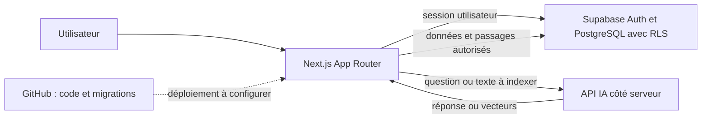
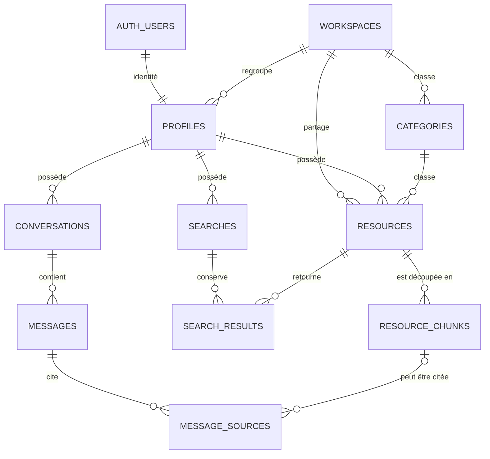

# Architecture Spine — NexaMind AI

## Design Paradigm

**Application web modulaire en couches, dirigée par le serveur.** Les écrans Next.js présentent l’interface ; les actions serveur gèrent les mutations ; les services métier orchestrent les règles ; Supabase conserve et protège les données. Les appels au modèle IA restent côté serveur.

## Invariants & Rules

### AD-1 — Les intégrations sensibles restent côté serveur

- **Binds:** FR-5, FR-6, FR-7, FR-8
- **Prevents:** Deux parcours ne mettent pas l’IA, ses secrets ou la recherche vectorielle dans le navigateur.
- **Rule:** Les Server Components lisent les données ; les Server Actions gèrent toutes les mutations métier et appellent les services serveur dédiés. L’inscription est accessible sans session, mais seule la création de compte est permise au visiteur ; toute lecture ou mutation des données produit exige une session. Le serveur seul appelle le fournisseur IA et orchestre l’ingestion, la recherche sémantique et le RAG. Aucun secret IA ou clé Supabase privilégiée ne part au navigateur. Les interfaces respectent les contrats responsive et d’accessibilité d’EXPERIENCE.md : fonctions disponibles au toucher et au clavier, focus visible, états annoncés, contraste WCAG 2.2 AA et agrandissement du texte sans perte de contenu essentiel.
- **En clair :** le navigateur demande une action ; Next.js la vérifie et l’exécute, sans exposer la clé IA.

### AD-2 — Supabase est la source de vérité et RLS garde le dernier mot

- **Binds:** FR-1, FR-2, FR-3, FR-4, FR-8, FR-9
- **Prevents:** Une page ou une route ne peut pas accorder plus de droits qu’une autre ni exposer une ligne en cas d’oubli dans l’interface.
- **Rule:** L’authentification est Supabase Auth avec session en cookies SSR via `@supabase/ssr`. Chaque table exposée active RLS ; les Server Components et Server Actions utilisent le client Supabase associé à la session de la personne, afin que les politiques PostgreSQL s’appliquent aussi côté serveur. Une opération de confiance crée de façon idempotente l’unique workspace et son profil responsable initial avant l’ouverture des inscriptions ; chaque inscription crée ensuite un profil membre lié à ce workspace. **[ASSUMPTION]** Une contrainte d’unicité en base empêche la création d’un second workspace. Les migrations SQL versionnées dans le dépôt définissent le schéma, les permissions et les politiques. Les opérations système privilégiées (initialisation, migrations, purge) passent par un chemin de confiance distinct, avec des secrets conservés côté serveur et des droits limités à leur tâche ; les requêtes habituelles gardent la session utilisateur et RLS.
- **En clair :** Supabase vérifie l’identité et applique les permissions au niveau de la base, même si une page oublie de cacher un bouton.

### AD-3 — Les rôles et la propriété déterminent les actions autorisées

- **Binds:** FR-3, FR-4, FR-8, FR-9
- **Prevents:** Un membre ne gère pas les ressources d’un autre et ne consulte jamais son historique privé.
- **Rule:** Le MVP contient exactement un workspace ; toutes les inscriptions le rejoignent et ne peuvent pas en créer un autre. Tout membre connecté peut lire les ressources et catégories de ce workspace et créer ses ressources ; il ne modifie ou ne supprime que les siennes. Le responsable peut créer et modifier les catégories et gérer toutes les ressources. Chaque membre, responsable compris, ne lit, ne modifie et ne supprime que ses propres recherches et conversations. RLS applique ces règles à chaque table : les profils sont créés par l’inscription, leur propriétaire ne peut pas modifier son rôle ou son workspace ; ressources accessibles à tous les membres du workspace, écriture limitée au propriétaire ou au responsable ; catégories lisibles par tous, écriture réservée au responsable ; passages accessibles uniquement par le contrôle de leur ressource parente ; recherches, résultats, conversations, messages et sources accessibles uniquement au propriétaire de l’historique. **[ASSUMPTION]** Les vérifications RLS du workspace et du rôle responsable passent par des fonctions SQL privées qui retournent seulement un résultat oui/non, avec un chemin de recherche SQL fixé, afin d’éviter la récursion des politiques sur `profiles`.
- **En clair :** toute l’équipe voit les mêmes ressources, mais seul leur propriétaire ou le responsable peut les modifier ; l’historique reste privé.

### AD-4 — Les données ont un propriétaire et un cycle de vie commun

- **Binds:** FR-3, FR-4, FR-5, FR-8, FR-9
- **Prevents:** Les ressources, passages indexés et historiques ne divergent pas sur leur propriétaire ou sur leur parent.
- **Rule:** `resources.owner_id` identifie le membre créateur ; `resource_chunks.resource_id` rattache chaque passage à sa ressource ; `searches.owner_id` et `conversations.owner_id` rattachent l’historique à son propriétaire ; `search_results.search_id` et `messages.conversation_id` rattachent leurs éléments à leur parent ; `message_sources.message_id` rattache une source au message qui la cite. Le parcours UX conserve la réponse et signale qu’une source n’est plus disponible après modification ou suppression de la ressource. **[ASSUMPTION]** Le schéma garde une référence nullable au passage, détachée lors de la modification ou suppression, sans supprimer la réponse ni conserver le texte retiré. **[ASSUMPTION]** Les ressources portent un numéro de révision et un état `processing`, `ready` ou `failed` : le début d’une révision met à jour le texte, incrémente sa révision et retire les anciens passages dans une fonction PostgreSQL atomique ; la publication des nouveaux passages est une autre fonction atomique, acceptée seulement pour la révision courante. Les deux fonctions vérifient le propriétaire ou le rôle responsable sous RLS. Une erreur laisse la ressource non interrogeable et marquée en échec ; une nouvelle modification ne peut pas être écrasée par une indexation plus ancienne. La date d’expiration est fixée à 30 jours après la dernière activité effective (nouvelle recherche ou nouveau message), sans renouvellement par une simple consultation ; RLS masque les lignes à l’échéance. **[ASSUMPTION]** Supabase Cron purge ensuite les lignes expirées et leurs enfants. Une suppression confirmée de ressource retire aussi ses passages vectoriels.
- **En clair :** les résultats d’IA restent attachés aux bons textes, et l’historique cesse d’être accessible après 30 jours.

### AD-5 — Le RAG utilise le même contexte autorisé pour retrouver et répondre

- **Binds:** FR-5, FR-6, FR-7, FR-9
- **Prevents:** L’assistant ne cite pas un contenu qui n’a pas été retrouvé ni accessible au membre.
- **Rule:** Le serveur découpe le texte d’une ressource, fait calculer ses embeddings, puis conserve textes, liens et vecteurs dans Supabase PostgreSQL avec l’extension pgvector. **[ASSUMPTION]** Un service de recherche unique combine la recherche plein texte PostgreSQL et la recherche sémantique ; le réglage de classement est différé et testé sur le jeu de requêtes du MVP. Les deux chemins ne retournent que des ressources `ready` autorisées par RLS ; les tests de pertinence s’exécutent avec RLS active et ne contournent jamais les droits pour compléter les résultats. À la réouverture d’une recherche enregistrée, le serveur relance la requête sur les ressources actuellement disponibles et remplace les anciens résultats par les résultats recalculés. Pour une question, le serveur calcule l’embedding de la requête, transmet les passages retenus au modèle, vérifie que les références de source retournées appartiennent à ces passages, puis conserve la question, la réponse et les sources affichées dans la conversation. Une conversation rouverte accepte une nouvelle question ajoutée au même historique, en tenant compte du contexte des échanges précédents ; chaque question possède un identifiant stable réutilisé lors d’une tentative explicite, afin d’éviter les réponses dupliquées. Le contenu envoyé à un fournisseur externe est limité aux données fictives ou explicitement autorisées ; **[ASSUMPTION]** la personne qui ajoute une ressource est responsable de vérifier cette autorisation pour l’usage avec le fournisseur choisi, et sa révocation entraîne la suppression ou le retrait de l’index de la ressource. Cette règle est appliquée à l’ingestion et aux questions ; elle ne crée pas de parcours de consentement supplémentaire dans le MVP. Les règles de traitement et de conservation du fournisseur doivent être vérifiées avant son choix. En cas d’échec de génération, la question est conservée et l’utilisateur peut relancer explicitement. Sans contexte suffisant, l’assistant indique que les ressources ne permettent pas de répondre et propose de réessayer plus tard, sans relance automatique. Les validations PRD sont conservées : scénario à un utilisateur et 20 ressources, 9 recherches sur 10 en moins de 3 secondes, 9 réponses IA sur 10 en moins de 15 secondes (délai fournisseur inclus), au moins 8 requêtes sur 10 avec une ressource attendue dans les trois premiers résultats, au moins 8 réponses sur 10 sourcées et factuellement appuyées, et abstention pour les 3 questions sans réponse.
- **En clair :** l’assistant cherche seulement dans les ressources accessibles et montre d’où vient sa réponse ; sans source suffisante, il ne devine pas.

### AD-6 — GitHub héberge le code source ; le serveur Next.js reste à choisir

- **Binds:** Déploiement de l’application et de ses routes serveur
- **Prevents:** L’application ne dépend pas d’un hébergement statique incompatible avec l’authentification SSR et les appels IA côté serveur.
- **Rule:** Le dépôt GitHub est la source versionnée du code et des migrations. Le runtime de production doit utiliser Node.js 22 ou supérieur pour satisfaire les dépendances Supabase retenues. **[ASSUMPTION]** « Hébergement prévu : GitHub » désigne le dépôt, pas un hébergement d’exécution ; le serveur nécessaire à Next.js reste à choisir. GitHub Pages publie des fichiers statiques et ne convient pas aux routes serveur Next.js requises par cette architecture.
- **En clair :** GitHub garde le code ; le site a aussi besoin d’un serveur d’exécution, qui reste à choisir.

### AD-7 — Le fournisseur IA est paramétré hors du code

- **Binds:** FR-5, FR-7
- **Prevents:** Le fournisseur et les modèles ne sont pas dispersés ou exposés dans les composants de l’application.
- **Rule:** Le MVP appelle l’API OpenAI depuis le serveur : `gpt-6-luna` pour les réponses et `text-embedding-3-small` pour des vecteurs de 1536 dimensions. Les identifiants sont fournis par des variables d’environnement côté serveur ; le budget, les quotas et les règles de traitement des données doivent être vérifiés avant la réalisation. Seules des données fictives ou explicitement autorisées sont transmises à un fournisseur externe.
- **En clair :** OpenAI et ces modèles sont les choix retenus ; le budget et les quotas restent à définir.

## Consistency Conventions

| Concern | Convention |
| --- | --- |
| Noms | Tables et colonnes en `snake_case` ; modules TypeScript en `camelCase` ; routes selon les conventions `src/app` de Next.js. |
| Identifiants et dates | UUID pour les relations entre comptes, ressources et historiques ; dates en `timestamptz` ; durée de conservation des recherches et conversations : 30 jours. |
| Mutation et erreurs | Toutes les mutations produit partent d’une Server Action avec validation côté serveur ; les changements de révision et la publication des passages sont des opérations PostgreSQL atomiques appelées sous la session de l’utilisateur. Les migrations, l’administration initiale et la purge planifiée sont des opérations système séparées. Erreur retournée explicitement à l’interface, sans succès simulé. |
| Authentification et secrets | Session Supabase en cookies SSR ; RLS activée sur chaque table exposée ; clés de fournisseur conservées côté serveur et dans les secrets de l’environnement d’exécution. |
| Configuration | Aucun secret dans le dépôt ; `.env.local` reste local et ignoré par Git. Exécutions personnalisées non mises en cache publiquement. |

## Stack

Les versions présentes sont relevées dans le projet et les versions proposées ont été vérifiées le 28 octobre 2026. **[ASSUMPTION]** Les versions Supabase et IA non encore installées sont des cibles provisoires à verrouiller lors de l’implémentation.

| Name | Version |
| --- | --- |
| Node.js | 24.18.0 (environnement courant) |
| Next.js App Router | 16.4.3 (présent dans le projet) |
| React / React DOM | 19.3.0 (présents dans le projet) |
| TypeScript | 5.9.3 (présent dans le projet) |
| `@supabase/supabase-js` | 2.118.0 [ASSUMPTION] |
| `@supabase/ssr` | 0.12.7 [ASSUMPTION] |
| Supabase PostgreSQL | Géré par Supabase ; version d’instance non fixée dans le dépôt |
| Extension PostgreSQL `vector` (pgvector) | Gérée par Supabase ; version d’extension non fixée dans le dépôt |
| Supabase Cron (`pg_cron`) | Module Supabase géré ; purge d’historique [ASSUMPTION] |
| Supabase Storage | Inclus dans la plateforme ; non utilisé si le MVP reste limité au texte [ASSUMPTION] |
| OpenAI Responses API — génération | `gpt-6-luna` |
| OpenAI Embeddings | `text-embedding-3-small`, 1536 dimensions |

## Structural Seed

### Flux principal



### Données principales



`profiles` contient le rôle membre ou responsable et un lien vers l’utilisateur Supabase Auth. Un workspace unique, créé avant l’inscription des membres, est rejoint lors de la création du profil. `resources` contient le titre, le texte, la catégorie, le propriétaire et l’état d’indexation ; `resource_chunks` contient le texte découpé et son vecteur. `searches` conserve la requête et `search_results` conserve les résultats ; à la réouverture, ils sont recalculés pour remplacer les anciens résultats. `conversations` / `messages` conservent les échanges ; une nouvelle question posée dans une conversation rouverte est ajoutée au même historique en tenant compte du contexte précédent. `message_sources` conserve les références de sources associées aux réponses ; si une ressource est modifiée ou supprimée, la référence reste et signale que la source n’est plus disponible, sans conserver son contenu.

Les politiques RLS suivent le même propriétaire de bout en bout : une ligne `messages` ou `message_sources` est lisible seulement si la personne possède la conversation parente ; un passage ne peut être lu que si sa ressource parente est accessible. Les seules écritures de données produit proviennent des Server Actions et des opérations SQL atomiques qu’elles appellent sous la session de la personne.

### Organisation proposée [ASSUMPTION]

```text
src/
  app/                 # écrans App Router, Server Actions et Proxy SSR
  features/
    auth/              # inscription, connexion et contrôle de session
    resources/         # ressources, catégories et orchestration d’indexation
    search/            # recherche classique et sémantique
    assistant/         # actions de conversation, récupération RAG et réponses
    history/           # historique privé et suppression
  lib/
    supabase/          # clients serveur avec session SSR
    ai/                # appels serveur au modèle et aux embeddings
  types/               # types partagés générés depuis le schéma Supabase
supabase/
  migrations/          # schéma SQL, extension vector, contraintes et politiques RLS
```

### Déploiement et exploitation

- Le serveur de production doit pouvoir exécuter Next.js côté serveur ; un export statique ne suffit pas pour l’authentification SSR, les Server Actions et les appels IA.
- Les changements de schéma et de politiques sont versionnés dans `supabase/migrations/` et appliqués avant le code qui en dépend.
- **[ASSUMPTION]** Les secrets OpenAI et Supabase restent configurés dans les variables protégées de l’environnement d’exécution ; ils ne sont ni poussés sur GitHub ni intégrés aux bundles navigateur.
- Supabase Cron purge régulièrement les données d’historique après leur date d’expiration ; les requêtes RLS excluent déjà les lignes expirées.
- **Deferred:** La surveillance, la journalisation opérationnelle, la sauvegarde/restauration et la séparation des environnements ne sont pas définies pour le MVP ; elles devront être décidées avant un usage de production ou de données réelles sensibles.

### Accès par rôle

| Données | Membre | Responsable |
| --- | --- | --- |
| Profil et workspace | Lire son profil ; ne peut changer ni son rôle ni son workspace | Le rôle est administré hors du parcours d’inscription ; accès aux données d’espace selon les mêmes règles |
| Ressources partagées | Lire toutes ; créer, modifier et supprimer les siennes | Lire, créer, modifier et supprimer toutes |
| Catégories | Lire et choisir | Lire, créer et modifier |
| Recherches, résultats, conversations, messages et sources | Accéder et supprimer son propre historique ; messages et sources seulement via ses conversations | Accéder et supprimer son propre historique uniquement |
| Passages vectoriels | Lecture limitée par RLS aux ressources autorisées ; écritures uniquement dans le flux d’indexation serveur autorisé | Mêmes limites de lecture ; gestion des ressources gouvernée par le rôle responsable |

## Capability → Architecture Map

| Capability / Area | Lives in | Governed by |
| --- | --- | --- |
| FR-1 — Compte et connexion | `src/features/auth`, Supabase Auth | AD-1, AD-2, AD-3 |
| FR-2 — Tableau de bord | `src/app`, `src/features` | AD-1, AD-2 |
| FR-3 / FR-4 — Ressources et catégories | `src/features/resources`, PostgreSQL | AD-2, AD-3, AD-4 |
| FR-5 / FR-6 — Indexation et recherche | `src/features/search`, `src/lib/ai`, `resource_chunks` avec pgvector | AD-1, AD-4, AD-5 |
| FR-7 — Assistant RAG | `src/features/assistant`, Server Action, API IA | AD-1, AD-5, AD-7 |
| FR-8 — Historique | `src/features/history`, PostgreSQL | AD-3, AD-4 |
| FR-9 — Autorisations | politiques RLS PostgreSQL et contrôles serveur | AD-2, AD-3 |

## Deferred

- Définir le budget et les quotas d’usage avant la réalisation.
- Choisir le serveur nécessaire à Next.js ; confirmer si GitHub signifie dépôt source ou si un environnement d’exécution est déjà prévu.
- Déterminer le format, la taille et la stratégie de découpage des passages, le seuil de recherche vectorielle et le réglage de classement après essais sur les contenus du MVP, avec RLS active.
- **[ASSUMPTION]** Le MVP accepte uniquement du texte saisi ou collé et n’intègre pas de fichiers. L’usage de Supabase Storage dépendra de la portée retenue pour les contenus.
- Les noms finaux des champs, index et contraintes SQL seront fixés par les migrations d’implémentation ; le spine ne définit que les relations et invariants d’accès.
